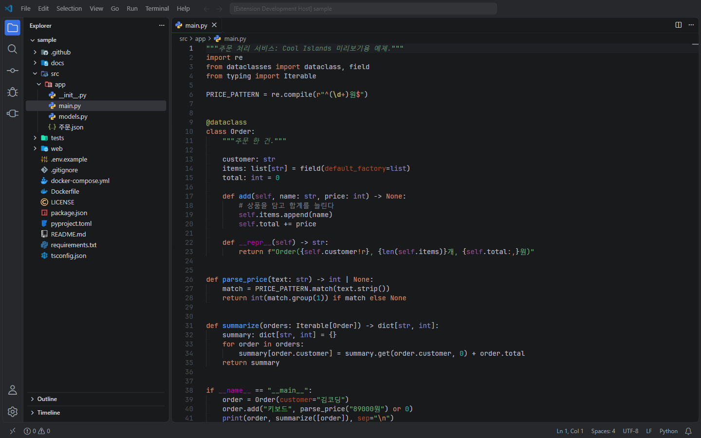
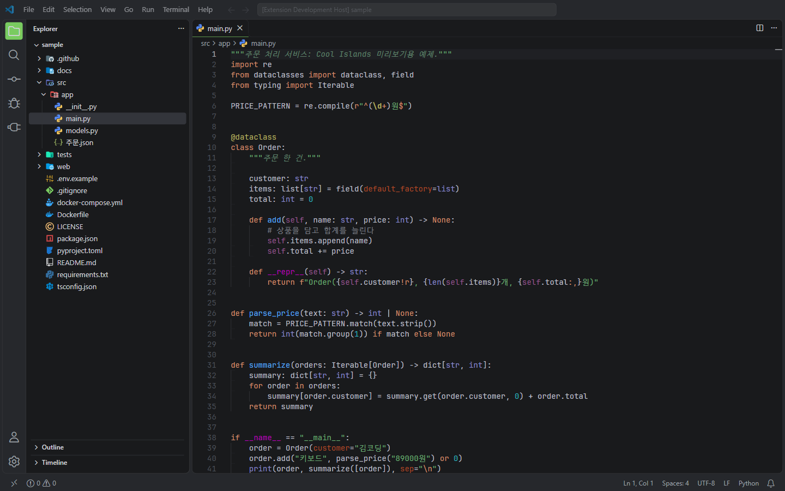
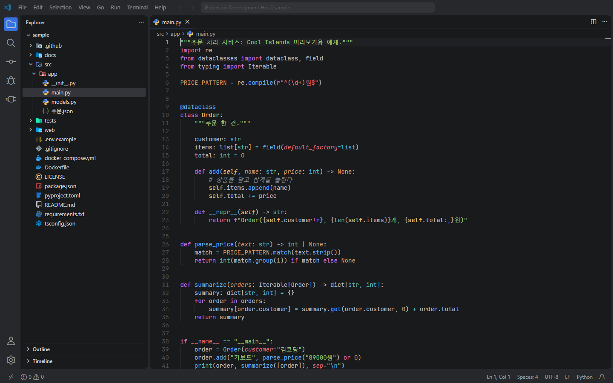
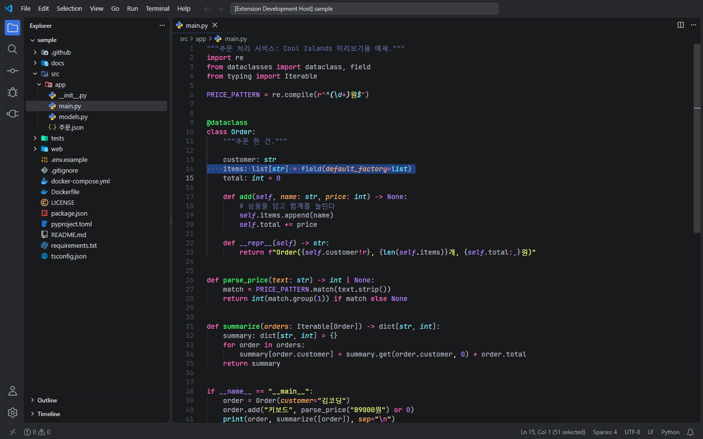
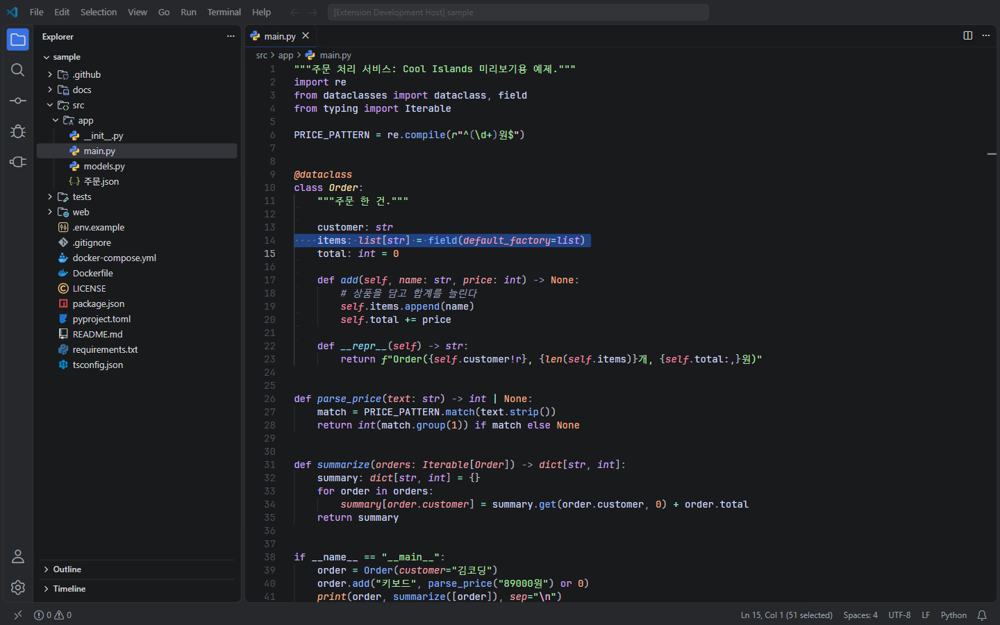
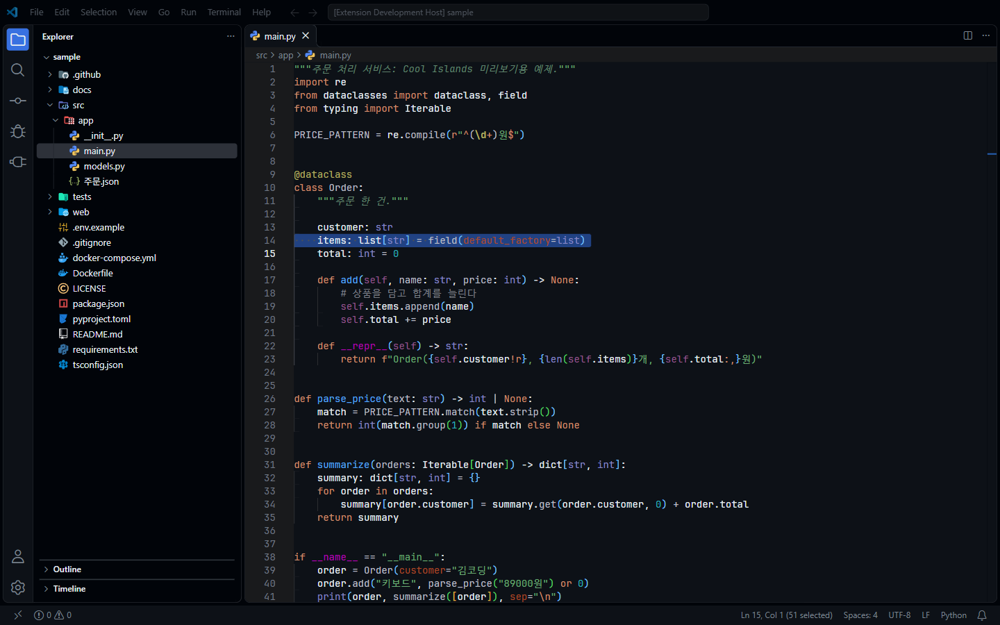
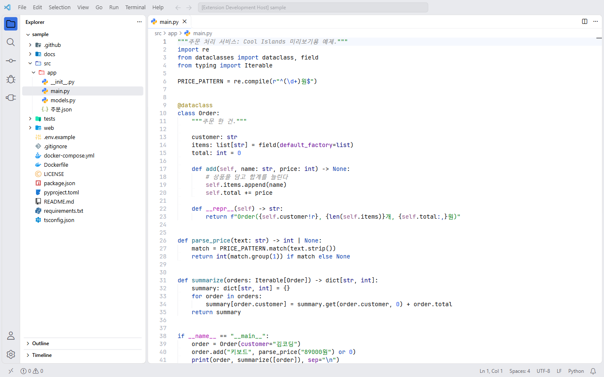
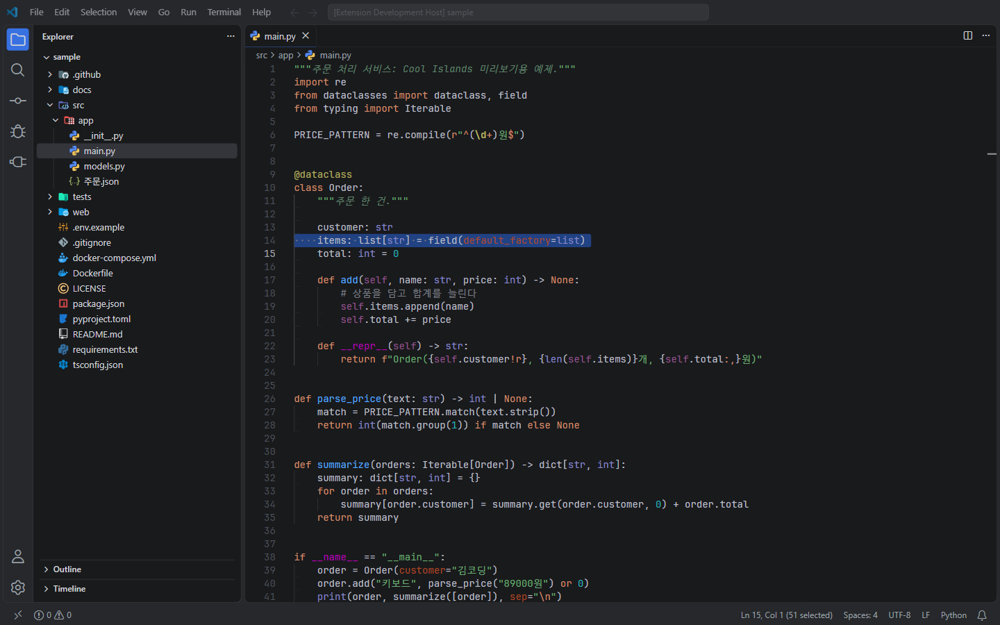

# 테마 조합(프리셋) 조사

`Cool Theme Kit: 테마 조합 고르기`(`choosePreset`) 명령에 넣을 내장 조합을 고르려고 2026-11-21 에 조사한 기록이다.
조합 데이터는 `src/presets/presets.ts`, 수치는 `bun run analyze:presets`(`src/scripts/presets/analyzePresets.ts`),
화면은 `bun run screenshots -- --preset <id>`(`docs/screenshots/presets/<id>.png`)로 다시 만든다.

## 1. 후보

Marketplace 설치 수 상위(2026-11-21 조회)에서 골랐다.

| 종류 | 확장 | 설치 수 | 이 키트에서 쓰는 방법 |
|---|---|---:|---|
| 파일 아이콘 | Material Icon Theme (`pkief.material-icon-theme`) | 36M | 기본 `iconThemeLayers` fill 층 (이미 기본값) |
| 파일 아이콘 | vscode-icons (`vscode-icons-team.vscode-icons`) | 25M | fill 층 |
| 색 | GitHub Theme (`github.github-vscode-theme`) | 21M | 틀(ui) override |
| 색 | One Dark Pro (`zhuangtongfa.material-theme`) | 13M | 문법(syntax) override |
| 색 | Dracula (`dracula-theme.theme-dracula`) | 11M | 문법 override |
| 색 | Tokyo Night (`enkia.tokyo-night`), Night Owl (`sdras.night-owl`) | 3~4M | 문법 override (비교만) |
| 색 + 아이콘 | Catppuccin (`catppuccin.catppuccin-vsc` + `catppuccin.catppuccin-vsc-icons`) | 1.5M + 0.7M | 문법 override + 폴더 아이콘 override |
| 제품 아이콘 | Fluent Icons 1.9M, Material Product Icons 0.7M, Carbon 0.3M | | `productIconThemeLayers` (프리셋에는 넣지 않음, 4장) |

JetBrains 계열 경쟁 확장(Darcula Theme 0.9M, JetBrains Icon Theme 0.4M, PyCharm Theme 0.16M)은 Islands(New UI) 모양도, 다른
테마를 얹는 기능도 없다. 그래서 조합은 "Islands 위에 인기 테마의 한 부분만 얹기"로 만든다.

## 2. 읽기 쉬움: 섞은 문법 색의 대비

섞은 Cool Islands 테마(`ColorThemeGenerator.createTheme`)에서 Python 토큰의 글자색을 그 테마의 `editor.background` 에 얹은
WCAG 대비. 기준은 본문 토큰 4.5:1, 주석 3:1(⚠ = 기준 아래). Islands Dark 배경은 `#191a1c`, Light 는 `#ffffff`.

| 조합 | 테마 | keyword | string | number | function | class | parameter | comment | 기준 아래 |
|---|---|---:|---:|---:|---:|---:|---:|---:|---:|
| jetbrainsDark | Cool Islands Dark | 6.4 | 6.4 | 6.4 | 6.9 | 9.4 | 3.1 ⚠ | 4.3 | 1 |
| jetbrainsLight | Cool Islands Light | 9.9 | 5.3 | 6.2 | 6.9 | 20.0 | 10.4 | 3.4 | 0 |
| materialGreen | Cool Islands Dark | 6.4 | 6.4 | 6.4 | 6.9 | 9.4 | 3.1 ⚠ | 4.3 | 1 |
| oneDarkSyntax | Cool Islands Dark | 5.9 | 8.6 | 7.1 | 7.4 | 10.1 | 7.1 | 4.6 | 0 |
| draculaSyntax | Cool Islands Dark | 7.3 | 16.3 | 7.2 | 12.7 | 12.6 | 10.2 | 3.7 | 0 |
| catppuccinMocha | Cool Islands Dark | 8.6 | 11.7 | 9.8 | 8.3 | 13.7 | 8.4 | 6.2 | 0 |
| githubDarkFrame | Cool Islands Dark | 7.0 | 6.9 | 6.9 | 7.5 | 10.2 | 3.3 ⚠ | 4.6 | 1 |
| (Tokyo Night 문법) | Cool Islands Dark | 9.4 | 9.5 | 8.6 | 6.9 | 4.3 ⚠ | 8.7 | 2.6 ⚠ | 2 |
| (Night Owl 문법) | Cool Islands Dark | 7.2 | 9.4 | 7.4 | 12.2 | 11.7 | 10.7 | 3.7 | 0 |
| (GitHub Dark Default 문법) | Cool Islands Dark | 6.9 | 11.3 | 9.0 | 8.9 | 9.0 | 14.7 | 5.7 | 0 |

- Islands Dark 의 매개변수 3.1 은 JetBrains 색 그대로다(PyCharm 의 매개변수 색이 원래 흐리다). 조합이 만든 문제가 아니다.
- 문법만 바꾼 조합은 모두 Islands 배경(`#191a1c`)이 원래 테마 배경(One Dark `#282c34`, Dracula `#282A36`)보다 어두워서 대비가 오히려 오른다.
- Tokyo Night 문법은 주석(2.6)과 클래스(4.3)가 기준 아래라 프리셋에서 뺐다. Night Owl·GitHub 문법은 기준은 넘지만 One Dark·Dracula 와
  성격이 겹쳐 뺐다(사용자가 `colorThemeLayers` 로 직접 고를 수 있다).
- GitHub Dark 틀(ui override)은 배경이 `#0d1117` 로 바뀌지만 Islands 문법 대비는 그대로 유지된다(매개변수 3.3, Islands 와 같은 이유).

UI 배경 차이(틀을 바꾸는 조합만 해당): GitHub Dark Default 는 `editor.background #0d1117`, `sideBar.background #010409` 로
Islands 의 `#191a1c`·`#191a1c` 보다 어둡고 푸르다. 다른 후보 테마의 배경은 One Dark Pro `#282c34`/`#21252b`, Catppuccin Mocha
`#1e1e2e`/`#181825`, Dracula `#282A36`/`#21222C`, Tokyo Night `#1a1b26`/`#16161e`, Night Owl `#011627`/`#011627`.

## 3. 아이콘 fill 층이 채우는 이름 수

Cool Icons 가 아이콘을 주지 않는 이름 중, 그 테마가 아이콘을 주는 이름의 수(그 테마 json 의 키에서 Cool Icons json 에 없는 키, 대소문자 무시).
fill 층이 실제로 채우는 수의 상한이다(확장자 접미사·언어로 이미 맞는 이름은 빠지지 않아 실제보다 조금 크다).

| 층 테마 | 파일 이름 | 확장자 | 폴더 이름 |
|---|---:|---:|---:|
| Material Icon Theme (기본) | 1454 | 470 | 2600 |
| vscode-icons | 1307 | 170 | 110 |
| Catppuccin Mocha Icons | 710 | 196 | 76 |

- Material 은 폴더 이름이 압도적으로 많아(2600) 기본 층으로 둔다.
- vscode-icons 는 파일 이름은 Material 과 비슷하게 채우고 폴더는 적다. vscode-icons 를 이미 쓰던 사람이 그 모양을 유지하는 조합으로 넣는다.
- Catppuccin 은 폴더 아이콘을 override 로 쓴다(Catppuccin 문법 색과 폴더 색을 맞추는 것이 목적). 파일은 fill.

## 4. 넣지 않은 것

- **제품 아이콘 층**: Fluent·Material Product Icons 는 New UI 아이콘(Cool Islands Icons)을 대신하는 테마라, "JetBrains 모양" 묶음의
  프리셋과 맞지 않는다. 섞기 화면 제품 아이콘 탭에서 고를 수 있다.
- **밝은 섞기 조합**: 인기 테마 중 밝은 문법을 가진 것(GitHub Light, Catppuccin Latte)은 Islands Light 와 대비 차이가 작아 효과가 적다.
  밝은 쪽은 JetBrains Light 하나만 둔다.

## 5. 결론: 내장 프리셋 8개

| id | 묶음 | 내용 | 필요한 확장 |
|---|---|---|---|
| `jetbrainsDark` | JetBrains | Islands Dark + Cool Icons + Islands Icons, 강조색·층 기본값 | – |
| `jetbrainsLight` | JetBrains | 같은 것, Islands Light | – |
| `materialGreen` | JetBrains | Islands Dark + 강조색 `#79cb60` + `accentTargets` 전부 (PyCharm Material Theme UI 모습) | – |
| `oneDarkSyntax` | 문법 | Islands 틀 + One Dark Pro 문법 | One Dark Pro |
| `draculaSyntax` | 문법 | Islands 틀 + Dracula 문법 | Dracula |
| `catppuccinMocha` | 문법 | Islands 틀 + Catppuccin Mocha 문법 + Catppuccin 폴더 아이콘 | Catppuccin, Catppuccin Icons |
| `githubDarkFrame` | 틀 | GitHub Dark Default 틀 + JetBrains 문법 | GitHub Theme |
| `vscodeIconsFill` | 아이콘 | 아이콘 섞기만: Material 대신 vscode-icons fill (색은 그대로) | vscode-icons |

글꼴은 프리셋에 넣지 않는다(키트 규칙: 글꼴은 사용자가 따로 고를 때만, `useJetBrainsFonts`).

## 6. 화면

`bun run screenshots -- --preset <id>` 는 격리 프로필(`--user-data-dir`·`--extensions-dir`·`--shared-data-dir`, 포크 #40)에만 필요한
확장을 설치하고 그 조합의 설정을 쓴 뒤 `docs/screenshots/presets/<id>.png` 를 찍는다. 사용자 VS Code 에는 아무것도 설치하지 않는다.

| | |
|---|---|
|  |  |
|  |  |
|  |  |
|  |  |

위 그림은 개발 모드(`--vsix` 없이)로 찍어 제목 줄에 `[Extension Development Host]` 가 남아 있다. 확인한 것: Dracula·One Dark·Catppuccin
문법 색이 Islands 배경 위에 섞였고, Material 연두는 활동 표시줄·폴더 아이콘이 연두, GitHub Dark 틀은 배경이 `#0d1117` 로 바뀌었다.
